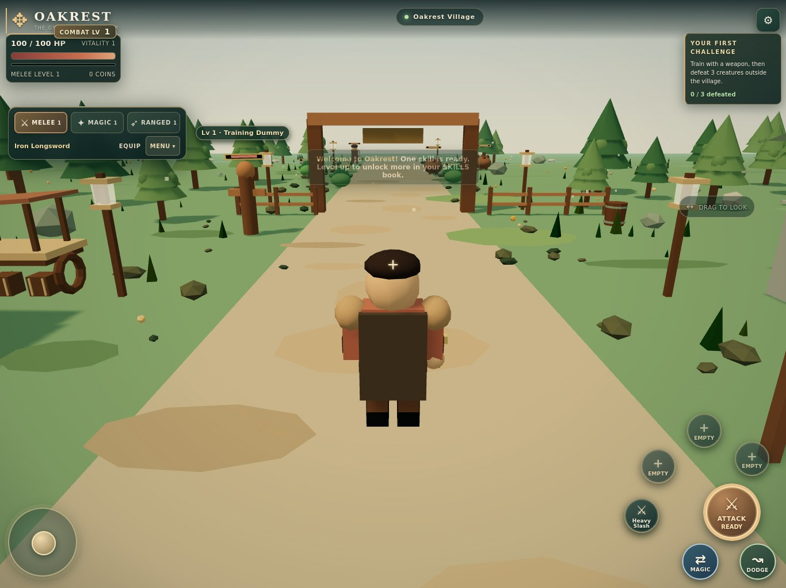
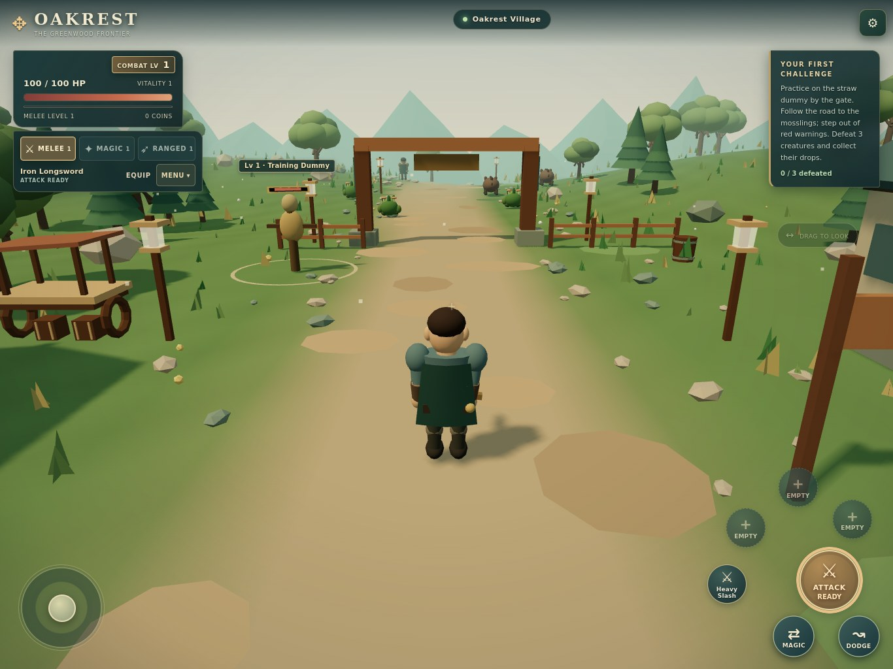

# Greenwood QA and release report

Date: 2026-10-20. Baseline: `ed8a1a1fd9a778779ae3c6e66f15400f5663a462`.
Branch: `overhaul/greenwood-gameplay-visuals`. [Draft PR #1](https://github.com/benhorner9/Projectoakrest/pull/1).

## Release status

**Implemented and locally tested; not signed off for production.** The GitHub integration has produced a READY preview for this overhaul. Protected preview access is denied with HTTP 403 by the connected Vercel account, including when requesting an authenticated share URL. The local Vercel CLI has no authenticated identity. No protection settings have been weakened, no production merge has been made, and no player data has been reset. Concurrent branch notes also describe a shared-host `/oakrest-dev` workflow; that host has not been deployed or verified by this QA pass. The Vercel preview is produced by the repository’s existing Git integration.

[Branch preview](https://projectoakrest-git-overhaul-greenwood-ga-8523ba-benhorner9-7909.vercel.app) requires authorized Vercel access. [Existing production](https://projectoakrest.vercel.app) remains on the pre-overhaul game. A successful Vercel build is not a verified browser playthrough of that deployment.

To unblock deployed verification, the connection must authorize the `projectoakrest` project (`prj_GEIjeTK0gzkM7fdX0e9rgs88H9mM`) in team `benhorner9-7909` (`team_8P1XS5ilh9Qt223i946ORxrB`). If that scope is already granted, an account with permission to access the protected deployment is needed.

## Architecture and baseline

The existing game is a static Three.js application: `main.js` coordinates rendering, simulation, UI and saving; rules, attack timing, input, motion, loot and combat patterns already live in small modules. The baseline has 67 passing tests. Original assets are procedural geometry and the engine used a CDN import. There is no account backend or database migration in this repository.

The main risks were save compatibility, shared cooldowns during simultaneous touch input, attack animation/damage timing, flat-ground assumptions, and additional geometry/shadow cost. The implementation preserves the existing rules modules and adds terrain/actor/environment helpers rather than rebuilding the game.

## Automated checks

- `npm test`: **97 passed, 0 failed** after integrating the concurrent branch work (77 passed before integration). Includes original progression/Combat Level/loot/control/aggro tests plus terrain continuity, collision, camera obstruction, swept projectiles, sloped ranged aiming, weapon animation clocks, dodge direction, actor rigs and save roundtrips. See [raw test output](../qa/unit-tests.txt).
- `npm run check`: all source modules parse. See [syntax output](../qa/syntax-check.txt).
- `npm run build`: static build produced with the engine bundled locally. See [build output](../qa/build.txt).
- Focused final smoke: desktop ranged hits on sloping terrain and portrait Settings access passed with no runtime errors. See [report](../qa/final-smoke-report.json).
- Browser harness: **22 passed, 0 failed**, no runtime JavaScript errors; see [machine-readable report](../qa/browser-report.json). Uses actual running Chromium/WebGL, isolated local saves and real pointer/keyboard input for controls. Encounter and progression scenarios also use a localhost-only deterministic simulation fixture to position actors and advance time.
- Covered basic attack windup, spam/cooldown rejection, queued style switching, continuous dodge, three simultaneous touch pointers, all three hostile types, XP gains, physical loot/collection, save reload, leash reset, death/respawn and compact menus.
- All **84 catalogue entries across 14 weapons** exercised in a separate high-level fixture, checking execution, damage/heal/shield/dash as applicable and cooldown enforcement. These are weapon-specific catalogue entries, not 84 unique ability designs. Real new players retain their unlock requirements.
- Browser console errors are recorded in the JSON report. All five tested viewport layouts have bounded controls/menu panels; the final fixture also includes Settings-button bounds.

The integrated upstream [browser smoke](../qa/integration-smoke.txt) also exercised character creation, all three tutorial training styles, skills reading, earning/using a travel scroll, entering the Realm portal, reaching Oakrest and reloading the saved character.

The harness is not a substitute for a natural 20-minute human playthrough. It does not prove that every ability animation looks ideal or that every status-effect combination is balanced. No real player profiles were used.

## Visual and input checks

Actual Chromium captures, not concept art:

| Layout | Viewport | Input |
| --- | --- | --- |
| iPad landscape | 1366 × 1024 | Touch emulation |
| iPad portrait | 1024 × 1366 | Touch emulation |
| Phone portrait | 390 × 844 | Touch emulation |
| Phone landscape | 844 × 390 | Touch emulation |
| Desktop | 1440 × 900 | Keyboard/mouse |

Screenshots include normal play and the open nonmodal menu at each size. Visual inspection covered terrain, actor visibility, world silhouettes, readable interface text and controls in the viewport. The small landscape menu is scrollable and retains access to the thumb controls, but occupies a substantial central portion of the short screen.

[Before](../qa/evidence/before-ipad.jpg) · [After](../qa/evidence/after-ipad.jpg) · [Village](../qa/evidence/after-village.jpg) · [Wilderness](../qa/evidence/after-outskirts.jpg)

The baseline is the original code with its engine import pointed to the same pinned local Three.js build for reliable measurement. Baseline instrumentation only exposes renderer counters. JPEG evidence is exported from full-resolution browser PNG captures without altering the game content.

## Measured performance

Linux headless Chromium, **SwiftShader software GPU**, 1366 × 1024, DPR 1, touch emulation, a stationary village camera, separate sequential browser contexts. This shared host is not representative of an iPad GPU. CPU contention and software rasterization affect the measurements; this is a diagnostic comparison, not a hardware certification.

| Build / quality | Sample | Mean FPS | p95 frame time | Draw calls | Triangles |
| --- | --- | --- | --- | --- | --- |
| baseline | 20.1s | 7.53 | 166.6 ms | 511 | 28,796 |
| greenwood-balanced | 20.1s | 6.20 | 183.4 ms | 428 | 66,292 |
| greenwood-low | 20.1s | 8.41 | 150.0 ms | 428 | 66,292 |

The initial overhaul submitted 134,808 triangles and measured 5.40 FPS at Balanced. Reducing terrain grid density and spatially partitioning static batches lowered the view to 65,590 triangles before the concurrent character/onboarding changes; the final integrated view submits 66,292 triangles and improves on the initial overhaul’s measured Balanced performance. Final Low is faster than the original on this host; final Balanced remains slower. **The 30/60 FPS target has not been demonstrated.**

Raw measurements: [initial baseline/comparison and 120-second Low run](../qa/performance-report.json), [final optimisation comparison](../qa/performance-final.json).

The final integrated browser suite also runs 60 seconds of real rendering with repeated attacks/effect creation, checks geometry growth remains bounded, checks effects stay below the limit, and records FPS/resource samples. The integrated attack/effect run began and ended at 276 geometries, one texture, 427 draw calls and zero live effects, with a median of the sampled rolling FPS values of 5.95. A separate 120-second pre-final-optimisation Low idle run stayed at 268 draws, 76 geometries, zero render-target textures and zero active effects. These short tests provide no evidence of an hours-long heap leak; renderer resource counts are not JavaScript heap measurements. Longer play sessions and heap profiling remain outstanding.

## Save preservation

The production origin and `oakrest-v1` key remain unchanged. Existing migrations retain XP, inventory, equipment, skills, coins, materials and ground loot. The first load stores the old raw value in `oakrest-before-greenwood`. If storage access, backup creation or parsing fails, writes are disabled to avoid overwriting unreadable progress. Browser tests compare the full valid save across reload; legacy/corrupt save cases are covered by rules tests.

Preview and production have different browser origins. A fresh character on a preview does not mean production progression has been reset; localStorage is origin-specific. No browser storage from an actual player was cleared or modified by this work.

## Remaining release gates and refinements

1. Obtain authorized access to the protected Vercel preview, verify its exact commit, and smoke-test the built output on its deployed URL before merging.
2. Perform a natural opening-session playthrough, including reading unlocks, choosing equipment, all three styles and returning to the village. The automated fixture covered the mechanics, not the full unaided onboarding experience.
3. Test physical iPad Safari, including sustained FPS, thermal behaviour, simultaneous thumb comfort, audio, rotation and save reload. No physical iPad was available. WebKit system-dependency installation was blocked by this environment's OS sandbox; Chromium viewport emulation is not Safari validation.
4. Run a longer combat/travel/gear-switch session with heap/resource profiling. Current samples are 60–120 seconds, not an hours-long soak.
5. Refine two-hand weapon contact and foot planting with IK if needed after human playtesting. The new rig is procedural; it has no full locomotion IK or cloth collision. Further authored landscape/prop variation would raise art quality without adding gameplay systems.

Do not label the brief's complete definition of done as met until these release checks are resolved. The branch and evidence are reviewable, the implementation runs locally, and production remains protected from an unverified release.

## Concurrent branch integration

During final publication, the remote branch was found to have advanced to `fe22bd63567c4ed5f86d6b777116d26e6b00f6e1`, adding character creation, tutorial/realm navigation and world collision. These changes were merged into an isolated working checkout, preserving all newer files and resolving the single ranged-targeting overlap using the active-area enemy list. The integrated code passed 97 regression tests, syntax/build checks, the existing fresh-character/tutorial/realm/legacy-save browser smoke suite, and the focused desktop slope-aim/portrait Settings smoke. The exhaustive legacy-world suite is recorded in `qa/browser-report.json`; earlier results are retained under `qa/pre-integration/`.
